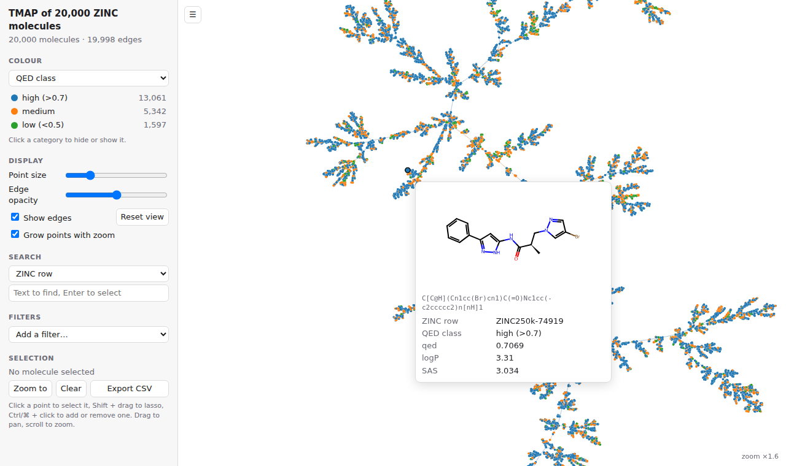

<h1 align="center">
  <picture>
    <source media="(prefers-color-scheme: dark)" srcset="https://raw.githubusercontent.com/pablo-mas/chemviz/main/docs/_static/logo-dark.svg">
    
  </picture>
</h1>

[](https://pypi.org/project/chemviz/)
[](https://chemviz.readthedocs.io)
[](https://github.com/pablo-mas/chemviz/actions/workflows/ci.yml)
[](https://github.com/pablo-mas/chemviz/blob/main/LICENSE)

Fast, easy-to-install visualization of molecule sets: interactive maps of their chemical space, from a few hundred molecules to millions.

chemviz maps molecules with [TMAP](https://doi.org/10.1186/s13321-020-0416-x) (Probst &
Reymond), UMAP, t-SNE or PCA, all reimplemented in pure Python + [numba](https://numba.pydata.org/):
molecules in, an interactive map out, in one line. There is nothing to compile and no conda
environment to set up, and it maps millions of molecules on a laptop.

**Documentation: [chemviz.readthedocs.io](https://chemviz.readthedocs.io)**, with a
[gallery](https://chemviz.readthedocs.io/en/latest/gallery.html) of interactive maps and a
[demo video](https://chemviz.readthedocs.io).



- **One line**: `cv.tmap("molecules.csv").save("map.html")`.
- **Four methods, one API**: `cv.tmap`, `cv.umap`, `cv.tsne` and `cv.pca` take the same inputs
  (SMILES lists, DataFrames, CSV/SDF files, fingerprints) and return the same map object.
- **Fast and light**: a TMAP of 250k molecules in ~10 s from SMILES, 1M in under 40 s, the
  whole of ChEMBL (2.9M) in under 2 minutes with ~4 GB of RAM. From the same MinHash vectors,
  that is 2.5–3× faster than the original tmap, with 3–4× less memory.
- **Interactive viewer**: a single self-contained HTML file (WebGL) that shows the structure
  on hover, colours, filters, searches, lasso-selects and exports to CSV. It also works offline,
  and in Jupyter its selection syncs with Python.
- **New molecules on an existing map**: `ref.project("hits.csv")` places them in seconds,
  without moving the map.
- **Static plots** with matplotlib, and a **command line**: `chemviz tmap molecules.csv -o map.html`.

## Installation

```bash
pip install chemviz
# or
uv add chemviz
# with the Jupyter widget (selections synced with Python)
pip install "chemviz[jupyter]"
```

Requires Python ≥ 3.12. Every dependency (RDKit, numba, numpy, pandas, matplotlib, joblib)
installs from wheels; UMAP and t-SNE need neither umap-learn nor openTSNE.

## Quick start

```python
import chemviz as cv

# Each method takes the same inputs: a CSV/SDF file, a DataFrame or a list of SMILES
# (the SMILES column is detected automatically).
m = cv.tmap("molecules.csv")    # tree map: series and their branching
m = cv.umap("molecules.csv")    # UMAP: tight, well separated clusters
m = cv.tsne("molecules.csv")    # t-SNE: clusters with fine local detail
m = cv.pca("molecules.csv")     # PCA: linear overview of fingerprints

m.save("map.html")              # interactive viewer, open it in any browser
m.plot(color="activity")        # static matplotlib figure
m.save("map.chemviz")           # the map itself, to reload with cv.load

hits = m.project("hits.csv")    # place new molecules on the map, without moving it
```

From a list of SMILES:

```python
smiles = ["CCO", "CCCO", "c1ccccc1O", "c1ccccc1N", "CC(=O)Nc1ccc(O)cc1"]
cv.tmap(smiles).save("tmap.html")
cv.umap(smiles).save("umap.html")
cv.tsne(smiles).save("tsne.html")
cv.pca(smiles).save("pca.html")
```

From the command line:

```bash
chemviz tmap molecules.csv -o map.html -o map.chemviz
chemviz project map.chemviz hits.csv -o hits.html
```

## Methods

| Method | What the map shows | ZINC250k | ChEMBL 1M |
|---|---|---|---|
| `cv.tmap` | A tree linking each molecule to a close neighbour: series and their branching are easy to follow, and nearest neighbours stay together. | 9 s | 37 s |
| `cv.umap` | Tight, well separated clusters; distances between clusters mean little. | 14 s | 58 s |
| `cv.tsne` | Clusters with fine local detail, well preserved neighbourhoods; distances between clusters mean little. | 90 s | 6.5 min |
| `cv.pca` | A linear projection of fingerprints: broad trends and gradients, but similar molecules overlap. | 5 s | 19 s |

Times are end to end from SMILES on a 20-thread desktop. chemviz's UMAP and t-SNE match the
quality of umap-learn and openTSNE on the same neighbour graphs, and are faster; see the
[benchmarks](https://chemviz.readthedocs.io/en/latest/benchmarks.html) and
[how to choose a method](https://chemviz.readthedocs.io/en/latest/methods.html).

## Credits

chemviz is an independent reimplementation of TMAP, MHFP, UMAP and t-SNE. If you use it,
please cite the original work (see [citing](https://chemviz.readthedocs.io/en/latest/citing.html)):

- D. Probst, J.-L. Reymond. *Visualization of very large high-dimensional data sets as minimum
  spanning trees.* J. Cheminform. 12, 12 (2020).
  [doi:10.1186/s13321-020-0416-x](https://doi.org/10.1186/s13321-020-0416-x)
- D. Probst, J.-L. Reymond. *A probabilistic molecular fingerprint for big data settings.*
  J. Cheminform. 10, 66 (2018).
  [doi:10.1186/s13321-018-0321-8](https://doi.org/10.1186/s13321-018-0321-8)
- L. McInnes, J. Healy, J. Melville. *UMAP: Uniform Manifold Approximation and Projection for
  Dimension Reduction.* arXiv:1802.03426 (2018).
  [doi:10.48550/arXiv.1802.03426](https://doi.org/10.48550/arXiv.1802.03426)
- L. van der Maaten, G. Hinton. *Visualizing Data using t-SNE.* J. Mach. Learn. Res. 9,
  2579–2605 (2008).
- P. G. Poličar, M. Stražar, B. Zupan. *openTSNE: A Modular Python Library for t-SNE
  Dimensionality Reduction and Embedding.* J. Stat. Softw. 109(3) (2024).
  [doi:10.18637/jss.v109.i03](https://doi.org/10.18637/jss.v109.i03)

## License

MIT
