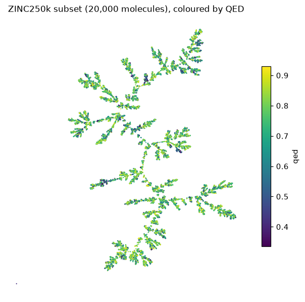

# chemviz

[](https://pypi.org/project/chemviz/)
[](https://github.com/pablo-mas/chemviz/actions/workflows/ci.yml)
[](https://github.com/pablo-mas/chemviz/blob/main/LICENSE)

Fast, easy-to-install chemical space visualization.

chemviz reimplements [TMAP](https://doi.org/10.1186/s13321-020-0416-x) (Probst & Reymond) in
pure Python + [numba](https://numba.pydata.org/): molecules in, an interactive tree map out, in
one line. There is nothing to compile and no conda environment to set up, and it maps millions
of molecules on a laptop.


- **One line**: `cv.tmap("molecules.csv").save("map.html")`.
- **Fast and light**: 250k molecules in ~4 s, 1M in ~17 s, the whole of ChEMBL (2.9M) in
  under 2 minutes with 4 GB of RAM. That is 3–3.5× faster than the original tmap, with 3–4×
  less memory (see [benchmarks](#benchmarks)).
- **Interactive viewer**: a single self-contained HTML file (WebGL) that shows the structure
  on hover, colours, filters, searches, lasso-selects and exports to CSV. It also works offline.
- **Static plots** with matplotlib, for papers and reports.
- **Command line**: `chemviz tmap molecules.csv -o map.html`.

## Installation

```bash
pip install chemviz
# or
uv add chemviz
```

Requires Python ≥ 3.12. Every dependency (RDKit, numba, numpy, pandas, matplotlib, joblib)
installs from wheels.

## Quick start

```python
import chemviz as cv

m = cv.tmap("molecules.csv")    # the SMILES column is detected automatically
m.save("map.html")              # interactive viewer, open it in any browser
m.plot(color="activity")        # static matplotlib figure
```

`cv.tmap` accepts:

| Input | Example |
|---|---|
| list, tuple or Series of SMILES | `cv.tmap(["CCO", "c1ccccc1O", ...])` |
| DataFrame with a SMILES column | `cv.tmap(df)` or `cv.tmap(df, smiles="canonical_smiles")` |
| file path: `.csv`, `.tsv`, `.smi`, `.sdf` | `cv.tmap("library.sdf")` (SDF properties become columns) |
| precomputed MinHash (`uint32`) or binary fingerprints | `cv.tmap(fps)` |

Invalid SMILES are skipped with a warning; their input positions are kept in `m.invalid`.

The result is a `TMap`:

```python
m.x, m.y          # coordinates (numpy arrays), one per molecule
m.edges           # (n - 1, 2) tree edges, as row positions
m.data            # the input rows (all columns, original index), minus invalid molecules
m.to_dataframe()  # data + x, y columns
```

## Command line

```bash
chemviz tmap molecules.csv                      # writes molecules.html
chemviz tmap molecules.csv -o map.html -o map.png --color pKi
chemviz tmap library.sdf -o coords.csv          # data + x, y coordinates
```

Each `-o` output is written according to its extension: `.html` (interactive viewer),
`.png` / `.svg` / `.pdf` (static plot) or `.csv`. Options mirror the Python API (`--smiles`,
`--columns`, `--offline`, `-k`, `--seed`…); see `chemviz tmap --help`.

## Interactive viewer

```python
m.save("map.html")                      # self-contained HTML file to open or share
m.save("map.html", columns=["pKi"])     # embed only some columns
m.show()                                # inline in Jupyter / VS Code notebooks
```

The viewer:

- draws the structure under the cursor, with the molecule's SMILES and properties;
- colours by any column: numeric columns get a colour bar, categorical ones a legend where a
  click hides or shows a category;
- filters by value range, category or text, and searches by identifier;
- selects by click or lasso (Shift + drag), zooms to the selection and exports it to CSV;
- lets you adjust point size and edge opacity, and follows the system light/dark theme.

Maps of a million molecules load in about a second. The data is compressed into the file:
250k molecules take ~12 MB and 1M ~40 MB.

**Offline use.** Structures are drawn with [RDKit.js](https://www.npmjs.com/package/@rdkit/rdkit),
loaded from a CDN when the page opens. To get a file that needs no network at all, embed it
(about 3.3 MB more):

```python
m.save("map.html", offline=True)
```

RDKit.js is downloaded once, checked against a pinned SHA-256 and cached in `~/.cache/chemviz`
(set `CHEMVIZ_CACHE` to use another folder).

## Static plots

```python
ax = m.plot(color="qed")               # numeric: colour bar (1st–99th percentile)
ax = m.plot(color="series", s=4)       # categorical: legend
ax.figure.savefig("map.png", dpi=200)
```



## Parameters

```python
cv.tmap(
    data,
    smiles=None,          # SMILES column name (guessed if omitted)
    k=10,                 # nearest neighbours per molecule
    kc=10,                # candidate pool k * kc ranked by exact distance
    n_permutations=128,   # MinHash size
    radius=2,             # ECFP radius
    n_trees=8,            # LSH Forest trees
    seed=0,               # layout seed (results are deterministic)
    n_jobs=None,          # processes for SMILES parsing (all cores by default)
)
```

## How it works

chemviz follows the TMAP pipeline:

1. **MinHash**: each molecule's unfolded ECFP substructures are MinHashed (`minhash_ecfp`).
   The Jaccard similarity of two molecules is the fraction of equal hash values.
2. **Approximate kNN with an LSH Forest** (`lsh_knn`): each tree indexes a band of hash values
   in lexicographic order, and candidates are the molecules that share the longest prefixes.
   They are ranked by MinHash distance.
3. **Minimum spanning tree** of the kNN graph (`minimum_spanning_forest`, Kruskal).
4. **Tree layout** (`tree_layout`): a multilevel force-directed layout (coarsening along the
   tree, Barnes–Hut repulsion on a quadtree), with disconnected components packed together.

Each step is available on its own:

```python
from chemviz import minhash_ecfp, lsh_knn, minimum_spanning_forest, tree_layout

hashes = minhash_ecfp(smiles)                    # (n, 128) uint32
idx, dist = lsh_knn(hashes, k=10)                # (n, k) neighbours and distances
edges, weights = minimum_spanning_forest(idx, dist)
pos = tree_layout(len(smiles), edges)            # (n, 2) float32
```

`mhfp` (RDKit's MHFP6 encoder) and `minhash_from_fingerprints` (MinHash of binary fingerprints)
are alternative encoders, and `read_molecules` loads a molecule file into a DataFrame.

## Benchmarks

Both tools were run on the same MinHash vectors. Times cover kNN, tree and layout; peak memory
is for the whole process. Measured on an Intel i7-12700K (20 threads) with 15 GB of RAM.

| Dataset | chemviz | tmap (original) |
|---|---|---|
| ZINC250k (249k) | **4.2 s**, 0.5 GB | 12.7 s, 1.5 GB |
| ChEMBL subset (1M) | **17 s**, 1.4 GB | 62 s, 6.2 GB |
| ChEMBL 37 (2.9M), end to end | **99 s**, 4.3 GB | out of memory |

Map quality, comparing chemviz with tmap:

| Metric | ZINC250k | ChEMBL 1M |
|---|---|---|
| kNN preservation (local) | 0.317 vs 0.321 | 0.431 vs 0.448 |
| Global structure | **0.776** vs 0.707 | **0.653** vs 0.633 |

- **kNN preservation**: the share of each molecule's 10 exact MinHash neighbours that are
  among its 10 nearest points in 2D.
- **Global structure**: the Spearman correlation between distance along the tree and distance
  in 2D.

Scripts are in [`benchmarks/`](https://github.com/pablo-mas/chemviz/tree/main/benchmarks).

## Credits

chemviz is an independent reimplementation of the ideas behind TMAP and MHFP. If you use it,
please cite the original work:

- D. Probst, J.-L. Reymond. *Visualization of very large high-dimensional data sets as minimum
  spanning trees.* J. Cheminform. 12, 12 (2020).
  [doi:10.1186/s13321-020-0416-x](https://doi.org/10.1186/s13321-020-0416-x)
- D. Probst, J.-L. Reymond. *A probabilistic molecular fingerprint for big data settings.*
  J. Cheminform. 10, 66 (2018).
  [doi:10.1186/s13321-018-0321-8](https://doi.org/10.1186/s13321-018-0321-8)

## License

MIT
