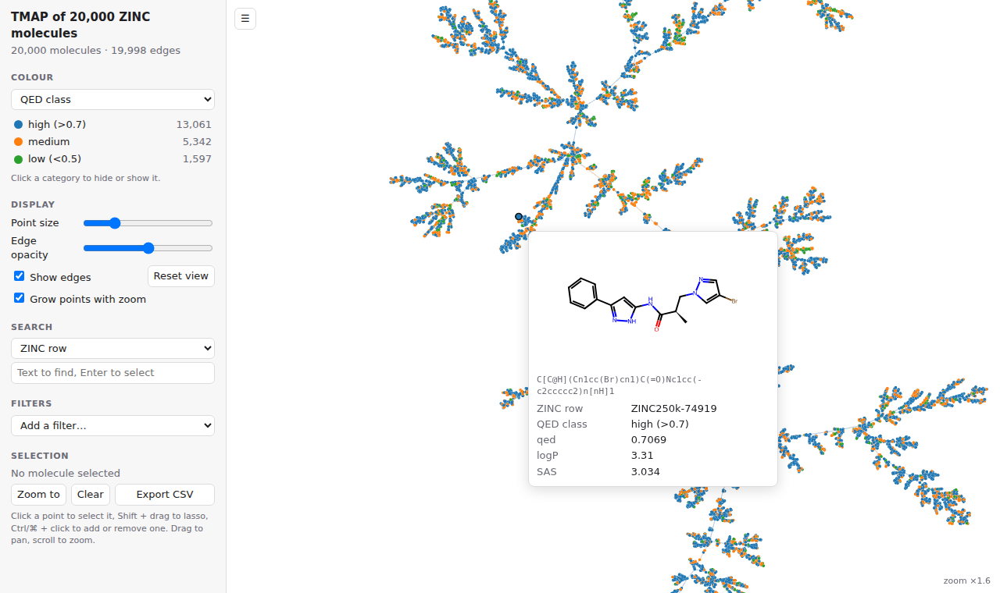

# chemviz

**Fast, easy-to-install chemical space visualization.**

chemviz maps molecules with [TMAP](https://doi.org/10.1186/s13321-020-0416-x), UMAP, t-SNE or
PCA, all reimplemented in pure Python and [numba](https://numba.pydata.org/): molecules in, an
interactive map out, in one line. There is nothing to compile and no conda environment to set
up, and it maps millions of molecules on a laptop.

```python
import chemviz as cv

cv.tmap("molecules.csv").save("map.html")
```



- **Four methods, one API**: `cv.tmap`, `cv.umap`, `cv.tsne` and `cv.pca` take the same inputs
  (SMILES lists, DataFrames, CSV/SDF files, fingerprints) and return the same map object.
- **Fast and light**: a TMAP of 250,000 molecules in about 10 seconds from SMILES, and the whole
  of ChEMBL (2.9 million molecules) in under 2 minutes with about 4 GB of RAM.
- **Interactive viewer**: a single self-contained HTML file that shows structures on hover,
  colours, filters, searches and selects, and works offline. In Jupyter, its selection syncs with
  Python.
- **New molecules on an existing map**: place screening hits or a new series on a reference map
  in seconds, without recomputing or moving it.
- **Command line**: `chemviz tmap molecules.csv -o map.html`.

## Where next

- {doc}`getting-started`: install chemviz, make a first map, and choose a method.
- {doc}`guide`: inputs, the viewer, saving maps, placing new molecules, Jupyter, large
  datasets and the command line.
- {doc}`gallery`: interactive maps of 20,000 molecules with each method.
- {doc}`api`: every function and parameter.

```{toctree}
:hidden:

getting-started
guide
gallery
how-it-works
benchmarks
api
about
```
