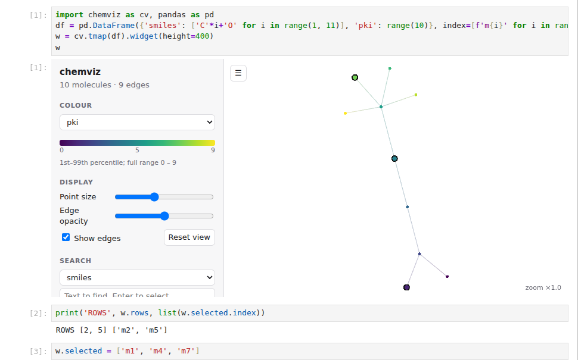

# Jupyter

Maps can be explored inside notebooks (JupyterLab, Jupyter Notebook, VS Code) in two ways.

## Displaying the viewer

{meth}`Map.show <chemviz.Map.show>` displays the viewer in the output of a cell. It needs no
extra package:

```python
m.show()
m.show(columns=["pKi"], height=500)
```

## Selections in Python

{meth}`Map.widget <chemviz.Map.widget>` displays the viewer as a widget whose selection is
synced with Python, both ways. It needs the `jupyter` extra:

```bash
pip install "chemviz[jupyter]"
```

```python
w = m.widget()
w
```

Select molecules in the viewer (click, Ctrl/⌘ + click, Shift + drag to lasso, or search),
then read them in the next cell:

```python
w.selected          # the selected rows of the map's data, with x and y, as a DataFrame
w.rows              # their row positions
```

Select molecules from Python by assigning index labels or a boolean mask; the viewer
highlights them:

```python
w.selected = ["CHEMBL25", "CHEMBL1201585"]      # index labels of the map's data
w.selected = (m.data["pKi"] > 8).to_numpy()     # a boolean mask, one value per molecule
```



To run code whenever the selection changes, observe `rows`:

```python
def on_select(change):
    print(f"{len(change['new'])} molecules selected")

w.observe(on_select, names="rows")
```

## Typical workflows

- **Inspect a region**: lasso a cluster of interest, then look at `w.selected` with pandas:
  property distributions, common scaffolds, activity.
- **Locate results**: compute something in Python (model predictions, a substructure
  search, a filter on several columns), assign the matching molecules to `w.selected`, and
  see where they fall on the map.
- **Pick compounds**: select molecules by hand across the map and save
  `w.selected.to_csv("picked.csv")`.
