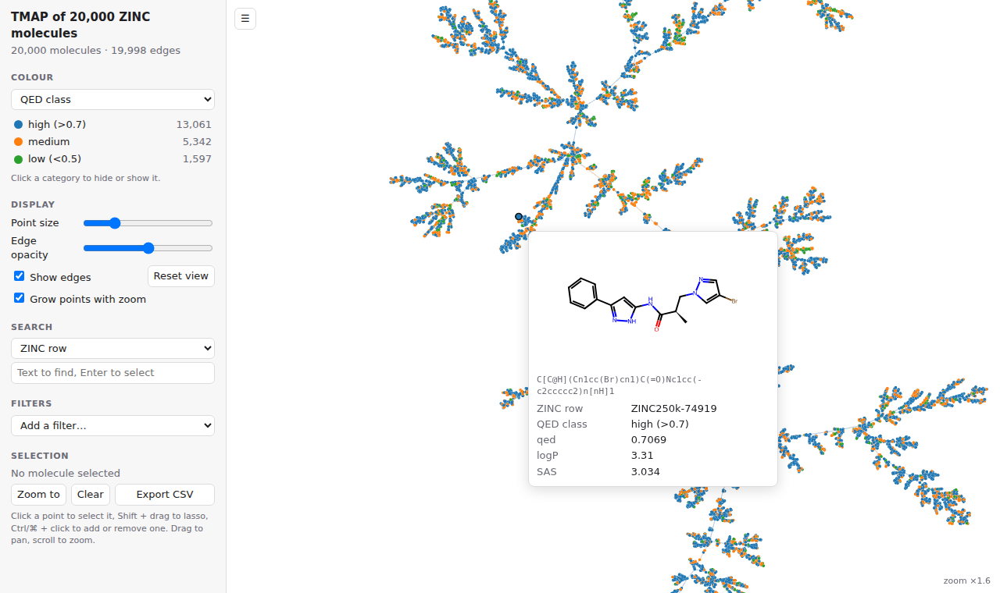
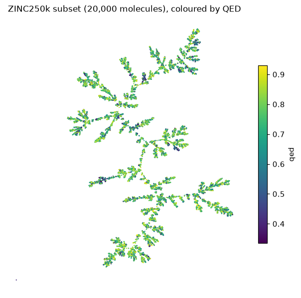

# The interactive viewer

Every map can be explored in chemviz's viewer: a single, self-contained HTML page that draws
millions of points with WebGL.

```python
m.save("map.html")    # open it in any browser, or send it
m.show()              # or display it in a notebook
```



## What it does

- **Structures**: hovering over a point draws the molecule, with its SMILES and the values
  of its columns.
- **Colours**: colour by any column. Numeric columns get a colour bar, scaled to their
  1st–99th percentiles. Columns with few distinct values get a legend in which a click hides
  or shows a category; beyond 20 categories, the rarest ones share a colour.
- **Search**: find molecules by the text of a column (an identifier, a name); matches are
  selected.
- **Filters**: show only the molecules within a range of values, in some categories, or
  matching a text. Filters on several columns combine.
- **Selection**: click a point to select it, Ctrl/⌘ + click to add or remove one,
  Shift + drag to select with a lasso. The selection can be zoomed to and exported to CSV.
- **Display**: point size, edge opacity and visibility (for TMAP), and a light or dark
  theme following the system. Points grow as you zoom in (up to 40 pixels), so that a
  zoomed-in region shows large, separate points; untick *Grow points with zoom* to keep
  them at the slider's size.

Drag to pan, scroll to zoom. The panel can be hidden with the ☰ button.

## Columns

By default, every column of the map's data is embedded. Numeric columns can colour and
filter; text columns with up to 1,000 distinct values (and fewer than half the number of
molecules) are categories, which can colour, filter and search; other text columns can be
searched and filtered. Every column is shown on hover.

Embedding fewer columns gives a smaller file:

```python
m.save("map.html", columns=["name", "pKi"])
```

The page title defaults to the file name; set it with `title=`.

## File size and speed

The data is compressed into the page: about 12 MB for 250,000 molecules and 40 MB for a
million, depending on the columns. Maps of a million molecules open in about a second in a
desktop browser.

## Offline use

Structures are drawn by [RDKit.js](https://www.npmjs.com/package/@rdkit/rdkit), loaded
from a CDN when the page opens. To get a page that needs no network at all, embed it (about
3.3 MB more):

```python
m.save("map.html", offline=True)
```

RDKit.js is downloaded once, checked against a pinned SHA-256 and cached in the user cache
folder: `~/.cache/chemviz` on Linux, `~/Library/Caches/chemviz` on macOS,
`%LOCALAPPDATA%\chemviz` on Windows (set the `CHEMVIZ_CACHE` environment variable to use
another folder).

## Sharing

The page is a single file with the data inside: it can be sent by email, put on a shared
drive or served by any web server, and opened without Python or chemviz. Everyone who has
the file can see all the embedded columns, so leave out confidential ones with `columns=`.

## Static plots

For figures in papers and reports, {meth}`Map.plot <chemviz.Map.plot>` draws the map with
matplotlib:

```python
ax = m.plot(color="qed")                # numeric: colour bar (1st–99th percentile)
ax = m.plot(color="series", s=4)        # categorical: legend; s sets the point size
ax.figure.savefig("map.png", dpi=200)
```



`edges=False` hides the tree of a TMAP, `cmap=` sets the colour map and `ax=` draws on
existing axes, for example to put several maps side by side.
